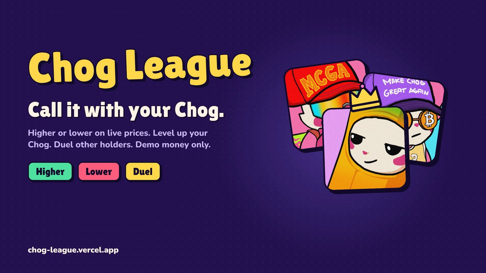
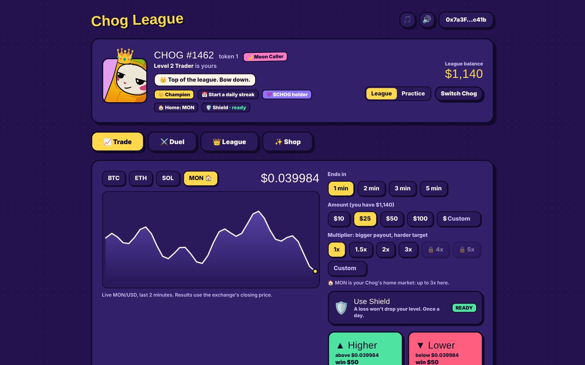
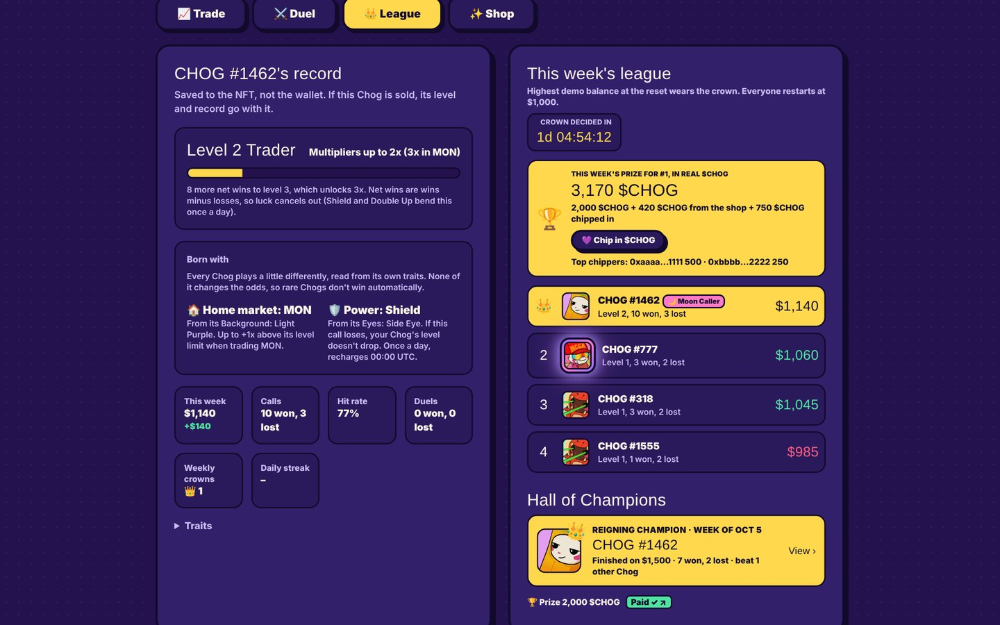
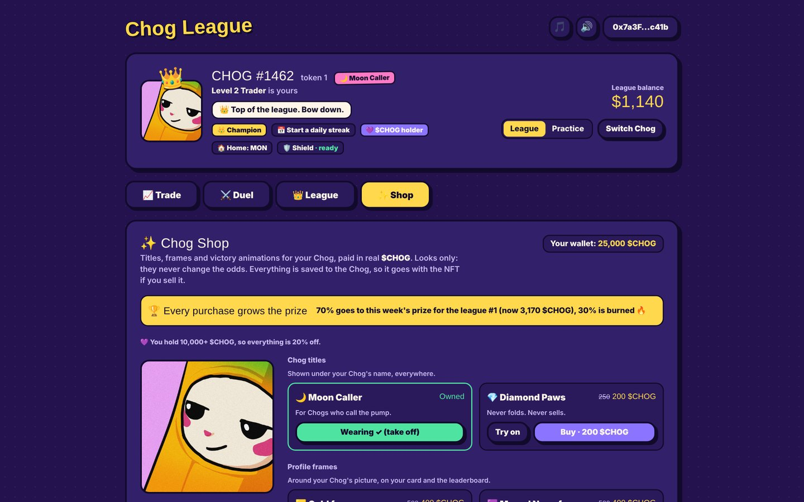
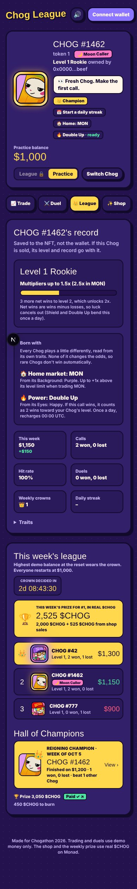

<p align="center">
  
</p>

<h1 align="center">Chog League</h1>

<p align="center">
  <b>Your Chog is a trading account.</b> Call crypto prices higher or lower, level up on skill,<br>
  duel other holders, and win the weekly <b>$CHOG</b> prize.
</p>

<p align="center">
  <a href="https://chog-league.vercel.app"><b>▶ Play free</b></a> ·
  <a href="https://youtu.be/-P0y_3-3mhw"><b>🎬 Demo video (2:40)</b></a> ·
  Built for <a href="https://chogathon.chog.xyz">Chogathon 2026</a> on Monad<br><br>
  <a href="https://github.com/Guzman0/chog-league/actions/workflows/ci.yml"></a>
</p>

---

## What it is

Pick a market (**BTC, ETH, SOL or MON**), call **HIGHER** or **LOWER** over 1 to 5 minutes, set your stake and a payout
multiplier, and watch the live price. Every call settles on real Coinbase prices at the close of the 1-minute candle when
it expires. Trading uses demo money, so a bad call never costs real funds.

The twist: **everything is saved to the Chog's token ID, never the wallet.** Its level, record, weekly crowns and
cosmetics travel with the NFT. Sell your Chog and the buyer gets a proven trader.

## Why the Chog is essential

- **The Chog is the account.** League play, levels, league duels and the crown only exist for a Chog, and only its owner
  can play it. Ownership is re-checked on Monad (`ownerOf`) before every trade.
- **Its level is proof of skill.** The odds are fair at every multiplier (see below), so luck cancels out over time and
  a Chog's level (wins minus losses) is a skill score.
- **No two Chogs play the same.** Each Chog's own traits decide its gameplay:
  - **Home market** from its *Background*: +1x multiplier limit when trading that market.
  - **Daily power** from its *Eyes*: 🛡️ Shield (a loss doesn't drop its level), 🔥 Double Up (a win counts twice) or
    🪂 Parachute (half the risk, half the profit). All keep the odds fair.
- **The Chog reacts.** It bounces with confetti on a win, shakes and greys out on a loss, burns on a hot streak, frosts on
  a cold one, and wears a 👑 as the league's number one.

Anyone can try it in **Practice mode** with any Chog and no wallet. Practice never counts toward records or the league.

## Screenshots

<p align="center">
  
  
</p>
<p align="center">
  
  
</p>
<p align="center"><sub>Screens from a test copy with example data (balances, prizes and players are made up).</sub></p>

## Features

| | |
| --- | --- |
| 📈 **Calls** | Higher or lower on BTC, ETH, SOL or MON · 1, 2, 3 or 5 minutes · stake $1–$500 · multiplier 1x–5x · up to 5 open at once |
| ⚔️ **Duels** | Chog vs Chog. See who's online and challenge them. Quick, best of 3 or best of 5 (hidden picks, 20-second window), or Arenas of 15 min, 1 hour or 24 hours. Equal demo stakes, winner takes the pot. Practice players can duel a bot. |
| 👑 **Weekly league** | Every Monday 00:00 UTC every Chog restarts at $1,000 demo. Highest balance wins the crown, the $CHOG prize and a place in the Hall of Champions. Daily streaks and power recharges. |
| 🪪 **Levels** | Rookie (1.5x) → Trader (2x, 5 net wins) → Sharp (3x, 15) → Shark (4x, 30) → Legend (5x, 50) |
| ✨ **$CHOG shop** | Titles (250), profile frames (500) and victory animations (1,000 $CHOG). Looks only, saved to the Chog. Free try-on. |
| 🏆 **Prize pot** | 2,000 $CHOG base + 70% of the week's shop sales + everything chipped in. The other 30% of sales is burned. Payouts and burns are linked on-chain ("Paid ✓", "burned ✓"). |
| 💜 **Holders** | Wallets with 10,000+ $CHOG get a holder badge on their Chogs and 20% off in the shop. |
| 💝 **Chip in & tips** | Anyone can add $CHOG to the weekly prize, or tip the reigning champion directly. |
| 🎵 **Sound** | Original sound effects and background music, made in code. |

## How the odds stay fair

A bigger multiplier pays more, but the target price moves further away, so the chance of winning shrinks to match.
For a multiplier *m*, the target is set so that:

```
win chance ≈ 1 / (1 + m)
target     = entry × (1 ± z(m) · σ · √minutes),   z(m) = inverse normal of m / (1 + m)
```

where σ is the market's recent 1-minute volatility. At 1x it's a coin flip; at 5x it's 1 in 6. Every setting has the
same expected value, so no option is a better deal and only good reads move a Chog up the levels. The rules live in
[`src/lib/game.ts`](src/lib/game.ts).

## How $CHOG payments work

1. The player sends $CHOG from their own wallet (a normal ERC-20 transfer on Monad).
2. The browser waits for the transaction and sends only its hash to the server.
3. The server reads the receipt from Monad and checks the `Transfer` log: right token, sent **from** the signed-in wallet,
   **to** the right address, at least the right amount ([`src/lib/payments.ts`](src/lib/payments.ts)).
4. Each transaction hash can be used once, across the shop, chip-ins and tips.

Trading and duels never use real money. $CHOG rewards play and is never gambled.

## Tech stack

- **Next.js 15** (App Router, TypeScript, Tailwind CSS v4)
- **wagmi v2 + viem** with a browser wallet; sign-in is a free signed message (no transaction)
- **Monad mainnet**: Chog Genesis NFT `0xc96d31F8626c6D03Fae5dCD3d61e3FB9F4a73763` · $CHOG `0x350035555E10d9AfAF1566AaebfCeD5BA6C27777`
- **Supabase** (Postgres) for trades, duels, purchases and the league; falls back to a local JSON file for development
- **Coinbase** public API for live prices and 1-minute candles (server-side only)
- Hosted on **Vercel**

## Project structure

| Path | What's there |
| --- | --- |
| [`src/lib/game.ts`](src/lib/game.ts) | Game rules: markets, multipliers, fair targets, levels, weekly balance |
| [`src/lib/identity.ts`](src/lib/identity.ts) | Home market and daily power, read from each Chog's traits |
| [`src/lib/duels.ts`](src/lib/duels.ts) | Duel formats, rounds, arenas and settlement |
| [`src/lib/shop.ts`](src/lib/shop.ts) | Shop items, prices, prize pot, holder discount (all numbers in one place) |
| [`src/lib/payments.ts`](src/lib/payments.ts) | On-chain $CHOG payment checks |
| [`src/lib/prices.ts`](src/lib/prices.ts) · [`settle.ts`](src/lib/settle.ts) | Live prices and settling expired calls |
| [`src/lib/store.ts`](src/lib/store.ts) | Database (Supabase, or a local file) |
| [`src/app/api/`](src/app/api) | Server endpoints: trade, duels, league, champions, shop, chip-in, tips, sign-in |
| [`src/components/`](src/components) | Screens: trade panel, Chog card, duels, leaderboard, shop |
| [`supabase/schema.sql`](supabase/schema.sql) | Database tables (safe to run more than once) |
| [`scripts/make-music.ts`](scripts/make-music.ts) | Generates the original background music |

## Run it yourself

You need [Node.js LTS](https://nodejs.org). On Windows, open the folder in VS Code and use **Terminal → New Terminal**.

```bash
git clone https://github.com/Guzman0/chog-league.git
cd chog-league
npm install
npm run dev
```

Then open http://localhost:3000. Without any settings, trades are saved to a local file in `data/`.

### Settings

Copy `.env.example` to `.env.local` and fill in what you need:

| Variable | Needed for |
| --- | --- |
| `SUPABASE_URL`, `SUPABASE_SECRET_KEY` | Saving to Supabase instead of a local file (run `supabase/schema.sql` once in the SQL Editor) |
| `SESSION_SECRET` | Signing sign-in cookies (required on Vercel; any long random string) |
| `NEXT_PUBLIC_RPC_URL` | A different Monad RPC (defaults to `https://rpc.monad.xyz`) |
| `CHOG_FAKE_PRICES=1` | Local testing without internet: made-up prices (ignored on Vercel) |

Never commit `.env.local`; it's already ignored by git.

## Running the weekly prize

Each Monday after the reset:

1. Open the League tab: the Hall of Champions shows last week's champion, the prize and the amount to burn.
2. Send the prize to the champion Chog's owner, and the burn amount to `0x000000000000000000000000000000000000dEaD`.
3. In Supabase → Table Editor → `payouts`, add a row: `week` = the Monday the finished week started (e.g. `2026-10-19`),
   `paid_tx` and `burn_tx` = the two transaction hashes. The "Paid ✓" and "burned ✓" links appear within a few minutes.

## Credits

Built solo by **Guzman** ([@the_first_guz](https://x.com/the_first_guz)) for Chogathon 2026, with Claude Code.
Chog art and traits come from the Chog Genesis collection's own
metadata. Fan-made for the hackathon; not an official Chog product.
